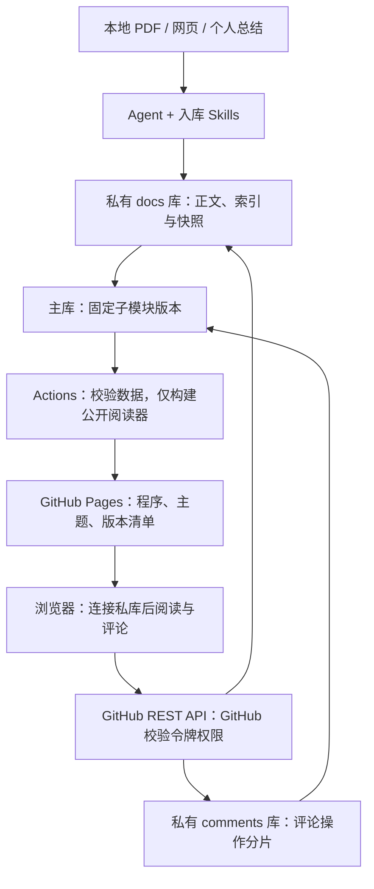

# 知识库构建执行方案 v1

更新日期：2026-10-20。状态：基础骨架已建立，私库接入与内容功能待实施。统一采用 GitHub Pages + 私有 docs/comments 子仓库，个人浏览器直连 GitHub API；无需自备服务器或额外业务托管。

## 1. 已确定的产品方向

| 事项 | 第一版决定 |
| --- | --- |
| 站点托管 | GitHub Pages，仅发布阅读器程序、主题和版本清单 |
| 内容管理 | 站点主仓库 + 私有 docs 正文子库 + 私有 comments 评论子库，以 Git submodule 引入 |
| 阅读体验 | 左侧列表、右侧内容；论文默认打开概述，中文翻译 Markdown 通过链接在阅读区渲染 |
| 内容检索 | 搜索概述、翻译、笔记和专题全文，结果带命中片段并跳到对应文档/段落 |
| 数据访问 | 浏览器填写限定私库权限的 GitHub 令牌，直接读取正文、搜索索引、附件和评论 |
| 密码入口 | 可保留参考站式界面门槛；实际数据权限由 GitHub 校验，不设业务登录接口 |
| 段落评价 | 整段评论或单段划词；同段多讨论，每组多评论，支持编辑 |
| 评论持久化 | 浏览器调用 GitHub API 写入私有 comments 库；按年/月/日/文档存有大小上限的 JSON 分片 |
| 正文改版 | 评论永久保留；无法确认位置时在页底展示，由库主人重新链接 |
| 技能 | 主库 skills/local/ 和 skills/third-party/，入库写入私有 docs 库 |

“评价”第一版指文字评论、疑问和灵感，不加入星级评分。Giscus 不进入主链路。跨段选区、PDF 原页批注、知识图谱、语义问答和多人协作后续再做。

参考 [chengwei 的 GitHub Pages](https://chengwei920412.github.io/index.html) 的分类、搜索、阅读布局及 [仓库子模块结构](repository-layout.md)。详细交互、概述结构与搜索要求见 [论文展示与检索规范](paper-reading.md)。源数据和索引不生成到公开页面；这样站点可继续使用 github.io，同时保留私有仓库数据权限。

## 2. 架构与职责



Git 是正式存储，浏览器内的讨论视图与索引缓存可重建。Pages 不运行业务后端。浏览器不会因为已经登录 github.com 就自动拥有 API 权限；个人版通过手动填写的 fine-grained PAT 连接私库，令牌只在当前标签页内存保存，刷新后需重新填写。

完整连接、权限及失败处理见 [浏览器直连 GitHub](browser-github-access.md)。技术依据包括 [GitHub REST 跨域支持](https://docs.github.com/en/rest/using-the-rest-api/using-cors-and-jsonp-to-make-cross-origin-requests)、[令牌认证](https://docs.github.com/en/rest/authentication/authenticating-to-the-rest-api) 和 [Git 对象写入](https://docs.github.com/en/rest/guides/using-the-rest-api-to-interact-with-your-git-database)。

## 3. 仓库结构

目标布局如下，尚未创建远程仓库或注册实际子模块。其他文档及技能中的 content/、catalog/、revisions/ 均相对于 docs 子库，annotations/ 相对于 comments 子库。

```text
knowledge_db/
  README.md
  AGENTS.md
  docs/                         # 设计文档，不是私人正文目录
  site/                         # 公开阅读器、主题、段落及 GitHub 适配器
  sources/
    docs/                       # 私有正文仓库 submodule
      content/papers/            # index 元信息、analysis 默认概述、translation、notes
      content/notes/
      content/topics/
      content/inbox/             # 草稿不进入正式目录/索引
      catalog/                   # 私有文档目录、标签与分页搜索索引
      revisions/                 # 不可变正文快照
    comments/                   # 私有评论仓库 submodule
      annotations/YYYY/MM/DD/<documentId>/part-000001.json
  release-manifest.json         # 公开版本 SHA，无私人标题和摘要
  templates/
  skills/local/
  skills/third-party/
  scripts/                      # 校验、私有索引生成、公开产物检查
  .github/workflows/
```

原始 PDF 下载到主库被忽略的 local-data/papers/，翻译技能原始输出到 local-data/translations/，中间文件到 local-data/work/；目录规则见 [本地工作目录](local-workspace.md)。这些流程仅由用户手动触发。正式入库后正文库登记来源与哈希；需要网页阅读的附件通过私库 API 读取。站点构建不能直接对 sources/docs/content 进行文章静态生成。详细仓库职责见 [多仓库与发布边界](repository-layout.md)。

## 4. 内容生产与更新

### 论文

1. 输入本地 PDF，补充可查证的原文链接、版本与元数据。
2. 按 DOI/arXiv ID、版本、文件哈希查重；同一论文的新版本归入原论文条目。
3. 提取章节、段落、图表和公式。无法可靠解析的位置标为待核对，不补写推测原文。
4. index.md 记录元信息和资源；按 [概述模板](../templates/paper-overview.md) 生成 analysis.md，作为默认阅读页，包含一句话总结、贡献、背景、方法、实验、局限及分析见解。translation.md 保存独立全文翻译与术语，笔记不混写。
5. 人工核对关键公式、结论与术语；个人理解写入 `notes.md`。
6. 生成稳定文档/段落 ID、正文快照和版本，登记 catalog 的概述/翻译/笔记映射，同步全文索引；校验引用影响，预览后提交。

### 网页与个人知识

网页入库记录 URL、标题、作者（能确认时）、访问日期，区分来源要点、自己的理解、验证记录、关联条目和待解决问题。Agent 新收集资料先进入 inbox；人工总结可直接进入正式笔记。专题页汇总多篇论文或笔记的比较与结论，引用原条目。

### 重新翻译或整理

1. 按固定文档 ID 找到旧文档、段落和已有评论；先生成变更候选，保留人工改动。
2. 只移动且内容不变的段落保留 ID；正文更改保留其延续身份，但旧评论需要重新确认；拆分、合并、全新段落生成新 ID。
3. 生成新快照与评论影响报告：仍有效、文字已改、段落移除、段落身份不可信。
4. 普通入库技能只改正文和快照，不改评论原始文件。展示解析器针对新版本判断状态。
5. 无法确认的评论自动落在文章页底；发布不因这些评论待链接而阻塞，但缺失评论或历史快照必须阻塞。
6. 对完全重译、无法证明段落延续关系的文档，旧评论全部待人工重新链接，不能把段落编号相同视为已迁移。

## 5. 段落评论体验

### 新增、回复和编辑

- 每个可评论文本段落有“评论此段”按钮；单段内选中文字时出现“引用并评论”。触屏设备始终可用整段按钮。
- 底部输入区展示段落位置和引用预览，输入文字后提交；空评论不提交。
- 成功写入 Git 后，当前页面显示评论与高亮；失败保留输入，并提供重试。
- 整段评论显示段落标记，划词评论高亮引用；点击可查看该讨论全部评论、追加与编辑。
- 同一段落可有多个讨论；只有目标段落、版本、范围完全一致的引用才建议追加到现有讨论。
- 重叠引用用分片展示高亮，点击列出涉及的讨论，不生成相互嵌套的高亮标签。

### 页底评论区与重新链接

页底始终显示本文全部讨论，默认优先展示“待重新链接”。已关联项有“跳转段落”，待链接项有原引用、创建时版本、原章节、评论全文和“重新链接”按钮。即使高亮组件失效，评论列表仍可阅读。

重新链接步骤：

1. 点击某讨论的“重新链接”，进入选段模式，并固定显示旧引用与评论。
2. 点击当前正文的目标段落；可选单段内文字，默认绑定整段。
3. 并排确认旧引用和新目标。点击“确认链接”才提交；“取消”不改动数据。
4. 浏览器适配器核对文档、正文版本和讨论修订号，通过 GitHub API 生成一次 commit；GitHub 校验实际仓库写权限。
5. 成功后恢复段落入口与高亮，并保留原引用和完整链接历史。重新链接移动整组讨论，评论 ID 与内容不变。

页面显示“这条评论最初针对旧版文字”，避免把旧判断当作对新正文的重新评价。不强制处理所有旧评论；允许长期留在页底，也允许撤销关联后重新选择。

## 6. 授权、保存与发布

- 用户一次输入的 PAT 需对 docs 与 comments 私库均授予 Contents 读写权限；同一令牌只保存在当前标签页内存。令牌不嵌入网页、不写持久存储、不提交 Git，不在聊天中收集。评论连接失败不得阻止 docs 阅读。
- 页面密码只控制入口体验，不用于兑换 GitHub 权限。第一版不设服务端 session、Cookie 登录或自建评论 HTTP 接口。
- 私人正文、搜索索引、附件、快照和评论只通过私库 API 进入浏览器内存；Pages 发布采用公开文件白名单，不含这些数据及其静态预渲染副本。
- 浏览器适配器校验字段、引用、修订和文件路径，GitHub 校验仓库权限；单用户客户端业务校验可被手动 API 请求绕过，CI 需重放并校验操作链。
- 每次评论操作保留 requestId 和预期修订；重试检查持久记录，避免重复评论。分片规则详见 [评论存储](comment-storage.md)。
- 以 comments HEAD 为并发基线，GitHub Git API 创建 commit 后非强制更新分支；失败时重读并检查修订，最多重试三次，不强制覆盖。分支规则需允许选定分支的个人写入。
- 正文目标按已读取的 docsCommit/contentRevision 校验。跨库无原子事务；若新正文发布与旧目标评论交错，保留旧引用并重新计算 pending，不丢记录。
- 保存成功后浏览器直接从私库读取最新评论；Pages 不必为显示评论正文重建。清单中的 commentsCommit 是发布快照，最新读取版本单独标明。
- 子库更新通过显式通知推动主库更新子模块引用及版本清单；Actions 只发布公开程序。不能假定子库 push 自动更新主库指针，也不能依赖 GITHUB_TOKEN 写入必然再次触发工作流。
- 备份三个仓库及版本清单，实际演练评论、正文快照与链接历史恢复。公开构建临时目录和日志不保留私人内容或令牌。

## 7. 分阶段执行清单

| 阶段 | 具体交付 | 完成标准 |
| --- | --- | --- |
| M0 数据契约 | 概述模板、论文入口映射、段落/快照、全文索引、评论分片 | 默认概述/翻译 ID 清晰；索引含正文及段落位置；跨日聚合完整 |
| M1 阅读骨架 | 两栏阅读器、默认概述、翻译链接渲染、全文搜索、手机抽屉 | 左侧选论文右侧显示概述；翻译可切换/返回；正文搜索可定位；不预渲染私文 |
| M2 段落评价 | 整段/划词、讨论浮层、回复与编辑、页底列表 | 同段多讨论、多评论及重叠引用可演示 |
| M3 改版保留 | 版本解析、待链接区、选段/确认/取消、关联历史 | 全文重译后评论 ID/数量不变；手动链接恢复定位 |
| M4 GitHub 直连 | 内存令牌连接、私库读取、Git 提交、幂等与冲突 | 真正浏览器跨域读写通过；每次操作一个 commit；令牌失效不丢草稿 |
| M5 Pages 发布 | 双私库子模块、Actions 校验、公开白名单、版本清单、备份 | github.io 可阅读；未授权只能取得程序；发布产物没有测试私文与索引 |
| M6 真实内容试用 | 3 篇论文、5 篇笔记、1 个专题，使用 skills 入库 | 至少一篇重译、一次拆段、一次理解重整，评论全部可找回 |

M2/M3 本地演示不算已实现线上持久化；M4/M5 完成后才可日常使用。执行顺序：数据契约 → 阅读器 → 评论 → 改版保留 → GitHub 直连 → Pages 发布与恢复 → 真实资料。

## 8. 验收场景

| 场景 | 预期结果 |
| --- | --- |
| 点击论文及中文翻译入口 | 默认展示概述，翻译 Markdown 在右侧渲染，左侧选中项保持，可返回概述 |
| 正文中英文词、仅翻译或笔记命中的词 | 全文结果包含片段，打开实际文档并定位；不只按标题检索 |
| 手机菜单、深链接刷新与浏览器前进/后退 | 布局可用，授权后恢复目标文档，概述/翻译不会混淆 |
| 整段评论、不同引用、同引用追加 | 讨论归属和数量正确，页底分页可查全部 |
| 编辑后刷新并重新连接 | ID 不变、修订增加，旧文字可从操作和 Git 历史恢复 |
| 移动段落、改标题/路径 | 身份不变，未改文字继续定位 |
| 重译、删除、拆分或合并段落 | 评论完整保留，待链接项显示原引用和版本 |
| 同句重复出现或相似翻译 | 不自动跨段吸附旧评论 |
| 重新链接再修改正文、撤销链接 | 历史完整，必要时再次 pending |
| 已检测到正文版本变化 | 要求刷新后重新选段，原讨论不变 |
| 网络重试、跨日重试、两窗口编辑 | 一个请求只保存一次；过期修订报冲突，草稿保留 |
| Git 保存成功但清单未更新 | 显示保存 SHA；通过私库刷新仍能读到评论 |
| 高亮失败、无有效段落 | 页底仍能读全部评论并继续回复 |
| 无授权直接获取 Pages HTML/JS/索引/路由/附件 | 只能取得公开程序和版本元信息，找不到测试私人内容 |
| 令牌无权限、过期、被撤销或限流 | 显示原因，停止相应读写，保留草稿 |
| 评论仓库权限缺失 | docs 仍可阅读和搜索；评论区显示连接错误并允许无令牌重试，不伪造保存成功 |
| 退出、刷新及检查本地持久存储 | 令牌不持久保存；私人缓存清理；重新连接体验符合说明 |
| Agent 更新、子库备份恢复 | 人工笔记、评论、原引用和链接历史完整 |
| 单日单文档分片超限 | 开下一片，跨片聚合不漏条，不生成全库大 JSON |
| 分支规则拒绝写入 | 明确报错，不强制推送或修改规则 |

## 9. 实施配置

仅需 GitHub 账户、站点主仓库、两个私有数据仓库、目标分支、Pages 和 Actions 配置。个人连接令牌在实际页面按需填写；CI 拉取子库的凭据放 GitHub Secrets，不能复用为公开页面内置令牌。自定义域名可选。

本地阶段先用数据适配器演示。外部仓库与凭据未配置时不假称线上已完成。当前已建立可运行阅读器外壳、初始化脚本、检查脚本及只检查/构建的 CI。私库适配器和内容功能待实施；不创建远程仓库、不部署网站，也不自动检索或翻译。
